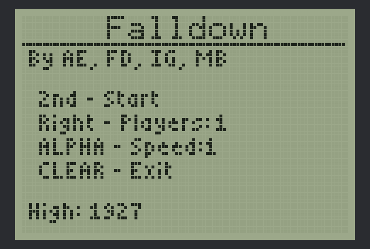
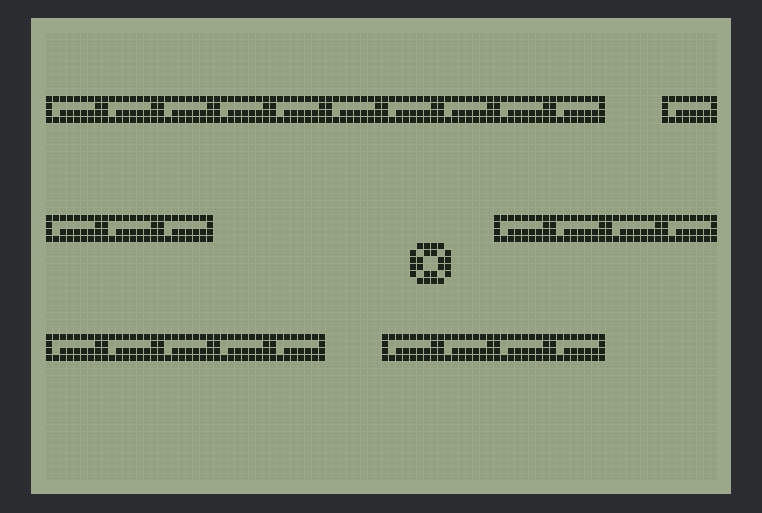

# Fall Down

<p><strong>⭐ If Fall Down is useful to you, please star it: click the ☆ Star button at the top right of the <a href="https://github.com/ventz/falldown">GitHub repo page</a>.</strong></p>

<a href="https://github.com/ventz/falldown/stargazers"></a>
<a href="LICENSE"></a>


A faithful desktop port of **Fall Down**, the TI-83 Plus assembly game, in Go.

<p>
  
  
</p>

Steer the ball down through the gaps in the rising shelves. If the shelves push it off the top of the screen, the game is over.

## Table of Contents

- [Quick Install](#quick-install)
- [Overview](#overview)
- [Features](#features)
- [Usage](#usage)
- [Two Players](#two-players)
- [Documentation](#documentation)
- [Credits](#credits)
- [Contributing](#contributing)
- [License](#license)

## Quick Install

Download the build for your system from the [latest release](https://github.com/ventz/falldown/releases/latest), unpack it and run `falldown`:

| System | File |
|---|---|
| macOS (Apple silicon and Intel) | `falldown-macos-universal.zip` |
| Windows | `falldown-windows-amd64.zip` (or `-arm64` for Windows on ARM) |
| Linux | `falldown-linux-amd64.tar.gz` (or `-arm64`) |

The builds aren't signed. On macOS, clear the download flag once with `xattr -d com.apple.quarantine falldown`; on Windows, choose **More info → Run anyway** if SmartScreen asks. `SHA256SUMS.txt` in each release lists the checksums.

To build from source instead (Go 1.25 or newer):

```bash
git clone https://github.com/ventz/falldown.git
cd falldown
go build -o bin/falldown ./cmd/falldown
./bin/falldown
```

`go install github.com/ventz/falldown/cmd/falldown@latest` works too. On Linux, Ebitengine needs the X11 and OpenGL development headers first (Debian/Ubuntu: `sudo apt install libc6-dev libgl1-mesa-dev libxcursor-dev libxi-dev libxinerama-dev libxrandr-dev libxxf86vm-dev libasound2-dev pkg-config`).

## Overview

This is not a remake drawn from memory. The game logic is a line-by-line port of the original Z80 source, which shipped inside the ticalc.org archives, and it runs on a small emulation of the calculator:

- the 96x64 graph buffer and LCD
- the Ion/MirageOS sprite, pixel and random routines
- the TI-OS text calls
- the HALT-driven frame timing

The brick layout and collision behave as they did on the calculator, and so does the speed. Both its quirks and its timing come with it.

Two releases are included:

| Version | Year | Who | What |
|---|---|---|---|
| **1.65** (default) | 2006 | Michael Bruno | Multiplayer edition: adds 2-player over the link cable |
| **1.5** | 1999 | Ian Graf | The classic Ion/MirageOS single-player port (`fdown.zip`) |

Both descend from Florent Dhordain and Ahmed El-Helw's 1998 FallDown.

## Features

- **Real-time feel.** The arrow keys are read straight from the keypad every frame, the way the original read the keypad port. The ball answers on the next frame and moves 2 pixels per frame.
- **The original speed.** Speed 1 runs at 60 fps and speed 2 at 40 fps (TI-83 Plus timing), derived from the calculator's interrupt rate and the cost of each frame.
- **The original quirks.** Collision tests whole 8-pixel bytes, so the ball only drops through a single hole from certain columns. A hole is forced only when the leftmost brick is present. Rows bunch together as the score climbs.
- **LCD look.** Grey-green glass, a faint pixel grid, and optional ghosting from the slow liquid crystal.
- **Saved settings.** High score, speed and player count persist, as MirageOS used to write them back into the program. They live in `falldown/settings.json` under your config directory: `~/Library/Application Support` on macOS, `~/.config` on Linux (or `$XDG_CONFIG_HOME`), `%AppData%` on Windows.
- **2-player link.** Two copies play in lockstep over TCP, using the same bytes the link cable carried.

## Usage

```bash
./bin/falldown                  # v1.65, TI-83 Plus timing
./bin/falldown -version 1.5     # the classic single-player release
./bin/falldown -model 84p       # TI-83 Plus SE / TI-84 Plus timing (55 / 37 fps)
./bin/falldown -ghost 0         # crisp pixels, no LCD ghosting
./bin/falldown -h               # all flags
```

| Calculator key | Keyboard | Does |
|---|---|---|
| Left / Right | arrow keys | Steer |
| 2nd | Space, Enter, Z | Start / continue |
| ALPHA | A, Tab | Toggle speed (title) |
| Right | Right arrow | Toggle 1/2 players (title, v1.65) |
| MODE | M | 1-player game: turn the calculator off (the original "pause"). 2-player game: quit, like CLEAR. v1.65 title and score screens: quit |
| ON | O | Wake up after MODE |
| CLEAR | Esc, Backspace, Q | Quit the game / quit to desktop from the title |

`G` toggles LCD ghosting and `F11` or `Alt+Enter` toggles full screen. On the title screen, `Speed: 1` is the fast setting.

## Two Players

v1.65 only. One side hosts and the other joins:

```bash
./bin/falldown                         # host (player 1), waits on :8383
./bin/falldown -join 192.168.1.20      # guest (player 2)
```

Between a Mac and a Windows PC, cross-compile the Windows build on the Mac (no Windows toolchain needed) and copy the `.exe` over:

```bash
GOOS=windows GOARCH=amd64 go build -o bin/falldown.exe ./cmd/falldown   # arm64 for Windows on ARM
```

The host listens on TCP 8383 only while its "Waiting..." screen is up, and stops once a player joins. Anyone who can reach that port can join during that time, so play on a network you trust. The host has to accept incoming connections on TCP 8383. Allow the program when the Windows Defender Firewall or macOS firewall prompts, and use the host's LAN IP with `-join`.

Choose `Players: 2` on both title screens, then press 2nd. Each screen shows both balls, and the game ends for both when either player dies. Like the original, the game runs in lockstep with one round trip per frame. It plays perfectly on a LAN but slows down over high-latency links.

## Documentation

- [Porting notes](docs/porting-notes.md): how the original works, the timing derivation, and each quirk that was preserved
- [`original/`](original/README.md): how to fetch the original ticalc.org releases, with the Z80 source and `.8xp` programs (`scripts/fetch-originals.sh`)

## Credits

The game was designed and written by Florent Dhordain and Ahmed El-Helw (FallDown, 1998). Ian Graf ported it to Ion/MirageOS (v1.5) and Michael Bruno added multiplayer (v1.65). The original releases are theirs and are not included here; `scripts/fetch-originals.sh` downloads them from ticalc.org. This repository is a port of their work.

## Contributing

Issues and pull requests are welcome. The goal is faithfulness to the calculator, so a change to game behavior should point at the matching lines in `original/v1.65-multiplayer/fdown.asm` (run `scripts/fetch-originals.sh` to get it). Before sending changes:

```bash
gofmt -l .
go vet ./...
go test ./...
```

`./bin/falldown -shot <dir>` renders the title, game and score screens as PNGs, which is how the screenshots in `docs/images/` are made.

## License

[MIT](LICENSE) © Ventz Petkov. The license covers the Go port only, not the original releases, which belong to their authors.
